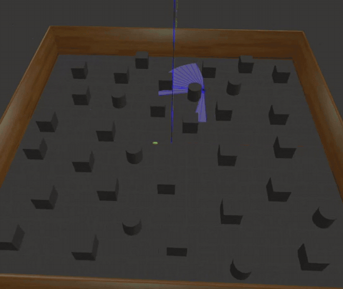
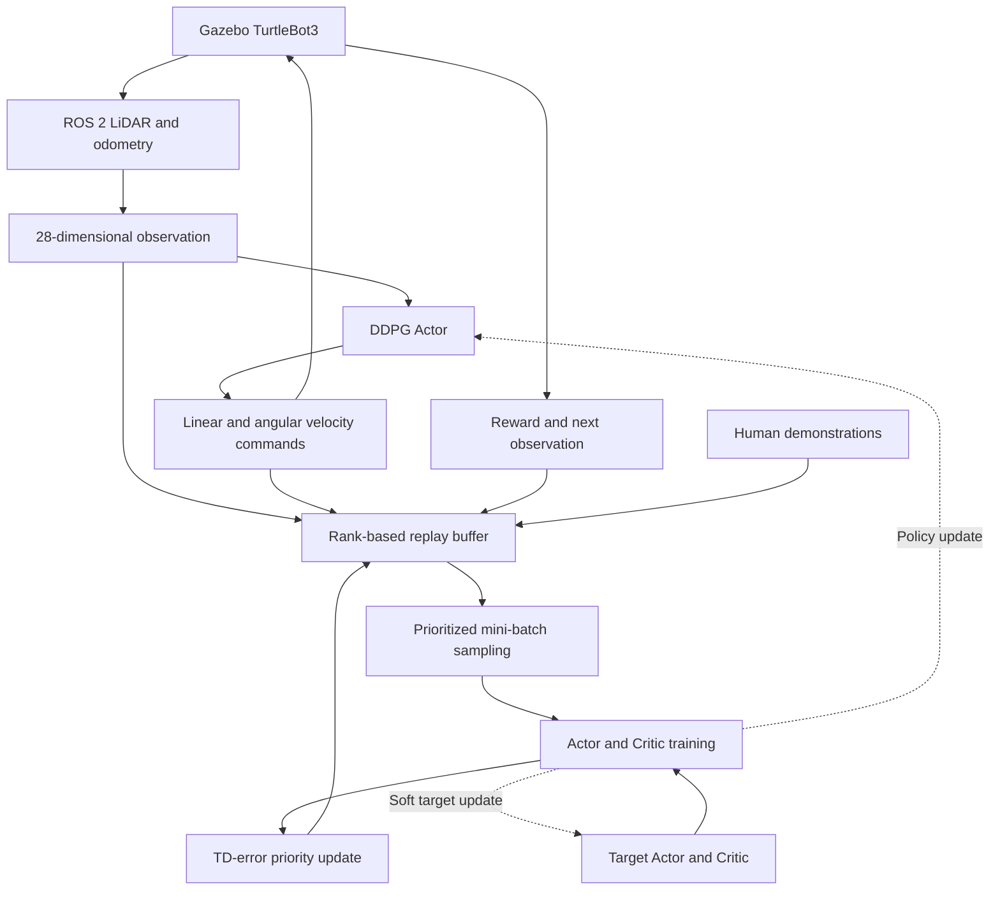

# Deep Reinforcement Learning for Autonomous AGV Navigation and Obstacle Avoidance

**Individual project | March 2026 – June 2026**

A simulation-based mobile robot navigation project using Deep Deterministic Policy Gradient (DDPG), rank-based Prioritized Experience Replay (PER), and human demonstration data. The policy learns continuous velocity commands for a TurtleBot3 mobile robot in ROS 2 and Gazebo maze environments.

## 1. Simulation Demo



## 2. Project Overview

The objective is to navigate a differential-drive mobile robot toward a target while avoiding obstacles using LiDAR and odometry feedback. Instead of relying exclusively on a hand-designed navigation policy, the robot learns a continuous control policy through interaction with a simulated environment.

Main contributions:

- Implemented and evaluated a DDPG Actor–Critic navigation policy.
- Integrated rank-based PER and recorded human demonstrations into the replay buffer.
- Built a ROS 2/Gazebo training and evaluation workflow with a 28-dimensional observation vector and two continuous control outputs.
- Compared the PER-based policy against an original DDPG baseline in simulated maze trials.

This project focuses on simulation and algorithm development; physical robot deployment and sim-to-real validation are outside its completed scope.

## 3. System Architecture



The Actor maps the observation to two continuous action values. ROS 2 transports velocity commands to Gazebo and returns sensor feedback. During training, the replay buffer stores transitions and the Critic estimates the value of state–action pairs.

### Observation and action spaces

| Component | Description |
| --- | --- |
| LiDAR | 24 normalized range measurements |
| Goal information | Distance and relative heading to the target, computed using odometry |
| Velocity information | Two commanded velocity values from the current step |
| Observation size | 28 values |
| Action size | 2 continuous values |
| Linear velocity | Actor output mapped to 0–0.26 m/s in the maze training script |
| Angular velocity | Actor output mapped directly to a command in −1 to +1 rad/s |

The environment publishes `Twist` velocity commands and receives `LaserScan` and `Odometry` messages through ROS 2. The reward combines progress toward the target, a goal-reaching bonus, and collision/proximity penalties. The simulator is paused and unpaused between control steps by the environment code.

## 4. Methodology

### DDPG Actor–Critic

DDPG is an off-policy reinforcement learning algorithm for continuous action spaces. The implementation uses separate online and target Actor/Critic networks.

- **Actor:** 28 inputs, three fully connected hidden layers of 500 neurons with ReLU activation, and two tanh outputs.
- **Critic:** separate 500-neuron embeddings for state and action, concatenated and processed through two 500-neuron hidden layers to estimate a scalar Q-value.
- **Training:** TensorFlow gradient computation, Adam optimization, and soft target-network updates.

The target value follows the DDPG Bellman target:

$$y = r + \gamma(1-d)Q_{\text{target}}(s',\mu_{\text{target}}(s'))$$

The Actor is optimized to maximize the Critic's estimated Q-value. In the PER implementation, the Critic uses an importance-weighted absolute TD error, rather than claiming a standard squared-error loss.

### Rank-based Prioritized Experience Replay

The baseline uses a replay buffer; the PER version ranks experiences using TD-error-based priorities and samples them according to a rank-dependent probability:

$$P(i) = \frac{\text{rank}(i)^{-\alpha}}{\sum_j \text{rank}(j)^{-\alpha}}$$

Importance-sampling weights are applied during Critic training. Priorities are updated from absolute TD errors. The replay implementation uses a binary heap to manage priorities.

### Human demonstrations

Recorded navigation transitions are loaded from MATLAB `.mat` files into the replay buffer. These data provide prior experience before or during reinforcement learning. This is replay-buffer initialization with demonstrations, not a separate imitation-learning or behavior-cloning objective.

### Selected training configuration

The following values are taken from `host/ddpg/MinhTri_Train_maze_per/common_definitions.py`; other experiment variants may use different settings.

| Parameter | Value |
| --- | ---: |
| Discount factor | 0.99 |
| Soft target update coefficient | 0.001 |
| Actor learning rate | 1e-4 |
| Critic learning rate | 1e-4 |
| Batch size | 512 |
| Replay capacity | 100,000 |
| Maximum training steps per episode | 750 |

## 5. Experimental Results

The following results are reported in the fixed-maze evaluation notes in [`host/ddpg/test/common_definition.py`](host/ddpg/test/common_definition.py). Each listed checkpoint was evaluated on 40 simulated maze missions.

| Method / checkpoint label | Trials | Recorded collisions |
| --- | ---: | ---: |
| Original DDPG (290 episodes / 100k) | 40 | 28 |
| Original DDPG + human data (190 episodes) | 40 | 2 |
| DDPG + PER, PER1 (240 episodes / 108k) | 40 | 0 |
| DDPG + PER, PER2 (200 episodes / 90k) | 40 | 0 |

**Key result:** the reported PER configurations recorded zero collisions in 40 simulated maze trials, compared with 28 collisions for the selected original DDPG baseline.

These are historical, checkpoint-specific results, not a new independent reproduction or a claim of statistical significance. Checkpoints differ in training duration and configuration. Zero recorded collisions does not by itself establish a 100% goal-reaching rate or safety on physical robots. The contribution of PER and demonstrations would require controlled ablations to isolate.

## 6. Repository Structure

```text
DDPG_FOR_AGV/
├── host/
│   ├── ddpg/
│   │   ├── maze_origin/             # Original DDPG baseline
│   │   ├── maze_PER/                # Maze DDPG with PER
│   │   ├── MinhTri_Train_maze_per/  # Maze training with demonstrations
│   │   ├── corridor_PER/            # Corridor training experiments
│   │   └── test/                    # Evaluation code, notes and weights
│   ├── turtlebot3_description/      # Robot description, launch files and worlds
│   ├── turtlebot3_dqn/              # Additional navigation experiment package
│   └── test_ddpg/                   # ROS 2 inference/testing package
├── README.md
└── ddpg_demo.gif
```

Key files in `host/ddpg/MinhTri_Train_maze_per/`:

| File | Purpose |
| --- | --- |
| `agent.py` | Actor, Critic, target networks, training and checkpoint operations |
| `rank_based.py` | Rank-based replay sampling and priority updates |
| `binary_heap.py` | Replay priority data structure |
| `train.py` | ROS 2/Gazebo environment and training loop |
| `record_human_action.py` | Recording demonstration transitions |
| `load_data.py` | Loading demonstration data from `.mat` files |
| `test_model.py` | Simulation policy evaluation |
| `common_definitions.py` | Training hyperparameters |

## 7. Technologies

- **Programming:** Python
- **Deep learning:** TensorFlow, Keras
- **Numerical computing:** NumPy, SciPy
- **Robotics and simulation:** ROS 2, Gazebo Classic (`gazebo_ros`), TurtleBot3, LiDAR, odometry
- **Algorithms:** DDPG, Actor–Critic, rank-based PER

## 8. Getting Started

The repository is a research workspace rather than a packaged, one-command application. Use a compatible ROS 2 installation with Gazebo Classic integration, ROS message/service packages, Python, TensorFlow/Keras, NumPy, SciPy, and `squaternion`. Exact dependency versions have not been pinned in the repository.

Clone the source:

```bash
git clone https://github.com/trilehoangminh-source/DDPG_FOR_AGV.git
```

Place or link the ROS packages under a ROS 2 workspace's `src/` directory, source the appropriate ROS installation, build with `colcon build`, and source the workspace's `install/setup.bash`. Inspect the package dependencies and launch arguments first.

For example, the description package provides a Gazebo launch entry point:

```bash
ros2 launch turtlebot3_description gazebo.launch.py
```

Choose a world matching the intended training or evaluation script. The launch file supports a `world` argument. Verify entity names, sensor topics, velocity commands and simulation services before running the agent.

The maze PER training entry point is `host/ddpg/MinhTri_Train_maze_per/train.py`; its current script is configured to load `minhtri_maze.mat` and resume a specific checkpoint. A matching four-network checkpoint must be supplied, or the script must be deliberately configured for a fresh run (including resetting episode and step counters). Do not assume a clone includes the checkpoint referenced by this script.

For evaluation, inspect `test_model.py` in the same folder and the scripts in `host/ddpg/test/`. Set the intended actor weights, world, and trial configuration before executing. Some `.weights.h5` files are included in the repository. These setup instructions are based on source inspection and have not been executed in a fresh environment.

## 9. Project Status and Future Work

- Evaluate across additional maze layouts and unseen goal locations.
- Conduct controlled comparisons of uniform replay, rank-based PER, and demonstration-assisted replay.
- Measure goal-reaching rate, timeouts, path efficiency and robustness alongside collisions.
- Package dependencies and experiment configurations for easier reproduction.
- Investigate sim-to-real transfer and physical robot validation in future work.

## 10. Author and Acknowledgments

**Le Hoang Minh Tri** — Control Engineering and Automation, Ho Chi Minh City University of Technology (HCMUT), VNU-HCM.

Individual project, March–June 2026.

GitHub: [trilehoangminh-source](https://github.com/trilehoangminh-source)

The project builds on established research in continuous-control reinforcement learning and prioritized replay. Thanks to the authors of DDPG and PER and the developers and maintainers of ROS 2, Gazebo and TurtleBot3 for the research and robotics tools that made this project possible. Credit for inherited robot descriptions, models and other third-party code belongs to their respective authors. The repository does not establish a complete upstream attribution or license for every inherited component; these should be verified before redistribution.

### References

- Lillicrap et al., [Continuous Control with Deep Reinforcement Learning](https://arxiv.org/abs/1509.02971).
- Schaul et al., [Prioritized Experience Replay](https://arxiv.org/abs/1511.05952).
